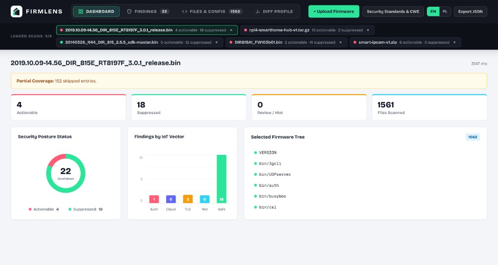

<p align="center">
  
</p>

<h1 align="center">FirmLens</h1>

<p align="center">
  <strong>Firmware-Aware Static Security Analysis · Redaction by Construction · IoT &amp; SmartHome Security Toolkit</strong>
</p>

<p align="center">
  
  
  
  
  
  
</p>

---

**FirmLens** is a deterministic static security analysis toolkit designed to detect hardcoded credentials, exposed cryptographic keys, and unsafe network/cloud configurations inside **IoT and SmartHome firmware** (`unpacked rootfs directories`, `.tar`, `.tar.gz`, `.tgz`, `.zip` archives, and `.bin` / `.img` / `.fw` / `.chk` / `.pat` binary images).

Built as an MSc cybersecurity research platform, FirmLens combines an independent **Rust analysis engine (`firmlens-core`)**, a **command-line interface (`firmlens-cli`)**, an optional **isolated Docker Binwalk v3 signature identifier**, and a **local Web Application (`firmlens-api` + `web/`)** with bilingual (`EN` / `PL`) support and SonarQube-style configuration inspection.

> [!IMPORTANT]
> **Redaction by Construction:** FirmLens never executes firmware, never validates credentials against live network services, and **never includes secret values, private key bodies, or reversible encodings** in reports, logs, or UI views.

---

## Application Preview

<p align="center">
  
</p>

* **Top Command Deck & Mouse 4/5 Navigation:** Full-width navigation dock (`Dashboard`, `Findings`, `Files & Config`, `Version Diff`) synchronized with browser history (`Back` / `Forward`).
* **Interactive Security Posture & IoT Vectors:** Clickable donut chart, IoT attack-vector bars (`Auth`, `Cloud`, `TLS/Key`, `Net/URI`, `Safe`), and live scan comparison (`Version Diff`).
* **SonarCloud / SonarQube Code Inspector:** Clicking any file path on a finding opens the file inspector, highlights the exact line/byte offset, and shows redacted evidence alongside remediation guidance.
* **Standards Mapping & Bilingual UI (`EN | PL`):** Every rule maps to **MITRE CWE**, **OWASP IoT Top 10**, and **ETSI EN 303 645**, with instant English/Polish switching.

---

## Technology Stack

| Layer | Technology | Version | Application in FirmLens |
| :--- | :--- | :--- | :--- |
| **Core Engine** |  `firmlens-core` | Stable (`rust-toolchain.toml`) · Edition `2021` | Bounded `TAR`/`TAR.GZ`/`ZIP` ingestion, isolated Binwalk unpack, Zip-Slip protection, lexical-contextual rule evaluation, redaction-by-construction, and Schema `2.2` report models. |
| **Pattern Matching** |  `aho-corasick` / `regex` | `1.1` / `1.11` | Multi-pattern automaton for binary `.dat`/`.bin` streams and structural syntax matching for PEM blocks, URIs, and config assignments. |
| **Archive & FS Safety** |  `tar` / `flate2` / `walkdir` | `0.4` / `1.1` / `2.5` | Pure-Rust streaming decompression (`BoundedReader`), symlink rejection (`follow_links(false)`), and atomic temporary workspace cleanup (`tempfile 3.15`). |
| **CLI Adapter** |  `firmlens-cli` (`clap`) | `4.5` | Deterministic command-line interface, terminal/JSON formatting, safe `--output` creation (`create_new`), and exit code semantics (`0/1/2/3`). |
| **Local HTTP API** |  `firmlens-api` | `0.8` / `1.0` | Loopback-only (`127.0.0.1:8787`) REST API with `Host`/`Origin` validation, bounded upload streaming (128 MiB), semaphore job control, and report diffing. |
| **Web Frontend** |    | `19.0` / `5.7` / `6.0` | Interactive SPA dashboard, Sonar-style config inspector, `EN/PL` localization, and client/server version diff visualization. |
| **Binary Identification & Extraction** |  `containers/binwalk` | `3.1.0` | Optional sandboxed signature identification and `--extract --matryoshka` unpacking inside a network-disabled, capability-dropped container (never a host binwalk fallback). |
| **Automation & Testing** |   | `3.10+` / `1.50` | Synthetic firmware fixture generation, USB/dropzone auto-scanner (`usb_watch.py`), CLI/API parity verifier, and E2E browser tests. |

---

## Quick Start (Easy Setup)

### Prerequisites
- **Rust** (stable toolchain via [rustup](https://rustup.rs/))
- **Node.js** (`22.12+` recommended) & `npm`
- **Python 3** (standard library only, used for fixture generation and helper scripts)

### Option A: One-Command Full Stack Launch (Recommended)
Generates synthetic IoT/SmartHome firmware archives, starts the local API (`127.0.0.1:8787`), starts the USB/dropzone watcher, and launches the Vite web interface (`127.0.0.1:5173`):

```bash
python3 scripts/task.py dev
```
*(Or simply run `make dev` on Linux/macOS).*

Then open **http://127.0.0.1:5173** in your browser and upload archives or binary images from `generated-fixtures/`:
- `generated-fixtures/rpi4-smarthome-hub-v1.tar.gz` (Vulnerable SmartHome hub)
- `generated-fixtures/rpi4-smarthome-hub-v2-hardened.tar.gz` (Hardened release for Version Diff)
- `generated-fixtures/smart-ipcam-v1.zip` (Vendor `.zip` firmware archive)
- `generated-fixtures/router-ota-image.bin` (Binary `.bin` OTA firmware image)
- `generated-fixtures/vulnerable.tar`, `generated-fixtures/hardened.tar.gz`, `generated-fixtures/benign.tar`

---

### Option B: Step-by-Step Manual Commands (2 Terminals)

**Terminal 1 — Build & Start Backend API (`127.0.0.1:8787`):**
```bash
cargo build --workspace --locked
python3 scripts/generate_archives.py
cargo run -p firmlens-api --locked
```

**Terminal 2 — Install & Start Web Frontend (`127.0.0.1:5173`):**
```bash
cd web
npm ci
npm run dev
```

---

## Command-Line Interface (`firmlens-cli`)

You can run FirmLens directly via `cargo run -p firmlens-cli --` or install the binary locally:

```bash
# Optional: install `firmlens` into ~/.cargo/bin
cargo install --path crates/firmlens-cli --locked
```

### Common CLI Commands

```bash
# 1. List all 12 detection rules with CWE, OWASP IoT Top 10 & ETSI mappings
cargo run -p firmlens-cli -- rules list

# 2. Scan an unpacked firmware directory (human-readable terminal output)
cargo run -p firmlens-cli -- scan fixtures/vulnerable

# 3. Scan a firmware directory or TAR/TAR.GZ archive and output JSON (Schema 2.1)
cargo run -p firmlens-cli -- scan fixtures/vulnerable --format json
cargo run -p firmlens-cli -- scan generated-fixtures/vulnerable.tar
cargo run -p firmlens-cli -- scan generated-fixtures/hardened.tar.gz --format json

# 4. Save JSON report to a new file (never overwrites existing files)
cargo run -p firmlens-cli -- scan fixtures/vulnerable --output report.json

# 5. Customize resource & ingestion safety limits
cargo run -p firmlens-cli -- scan generated-fixtures/vulnerable.tar \
  --max-input-bytes 67108864 \
  --max-expanded-bytes 134217728 \
  --max-extracted-files 5000 \
  --max-extraction-depth 24 \
  --ingestion-timeout-ms 15000
```

### CLI Exit Codes

| Exit Code | Meaning |
| :---: | :--- |
| `0` | **Full scoped coverage** completed; no error occurred (findings allowed unless `--fail-on-findings` is set). |
| `1` | **Fatal error** (invalid input path, unsafe output path, or report write failure). |
| `2` | **Partial coverage** (at least one file was excluded/skipped/truncated, e.g., excluded `.md` docs, or CLI syntax error). |
| `3` | **Actionable findings detected** on a full scoped scan when `--fail-on-findings` is enabled. |

---

## Optional: Isolated Binwalk v3 Signature Identification

FirmLens integrates **Binwalk v3 (`3.1.0`)** strictly inside a rootless/unprivileged Docker boundary (`--network none`, `--read-only`, `--cap-drop ALL`, memory/PID/CPU limits) to identify monolithic binary headers without exposing the host to parser vulnerabilities:

```bash
# Build the pinned local container image
docker build -t firmlens-binwalk:3.1.0 containers/binwalk

# Scan a binary image with isolated signature identification
cargo run -p firmlens-cli -- scan generated-fixtures/signature-test.bin --binwalk --format json
# Unpack opaque firmware images then scan the extracted tree (requires the same image):
cargo run -p firmlens-cli -- scan generated-fixtures/router-ota-image.bin --binwalk-extract --format json
```

> [!NOTE]
> Identified binary signatures are reported distinctly from extracted files. If Docker is unavailable, FirmLens records `unavailable` rather than falling back to unsandboxed host execution.

---

## Detection Rules & Security Standards (`FL001`–`FL012`)

| Rule ID | IoT Vector | Subject | MITRE CWE | OWASP IoT Top 10 | ETSI EN 303 645 |
| :---: | :---: | :--- | :---: | :---: | :---: |
| **FL001** | `Auth` | Hardcoded Password Assignment | `CWE-798` | `I1` Weak/Hardcoded Passwords | `5.1-1` |
| **FL002** | `Cloud` | Exposed MQTT Broker Credentials | `CWE-798` | `I1` Weak/Hardcoded Passwords | `5.1-1` |
| **FL003** | `TLS/Key` | Embedded Private Key Block (PEM) | `CWE-321` | `I3` Insecure Ecosystem Interfaces | `5.4-1` |
| **FL004** | `Auth` | Hardcoded API Key or Bearer Token | `CWE-798` | `I3` Insecure Ecosystem Interfaces | `5.4-1` |
| **FL005** | `Auth` | Generic Embedded Secret Assignment | `CWE-798` | `I1` Weak/Hardcoded Passwords | `5.4-1` |
| **FL006** | `Net/URI` | Credentials Embedded in Service URI | `CWE-522` | `I7` Insecure Data Transfer | `5.8-2` |
| **FL007** | `TLS/Key` | TLS Certificate Verification Disabled | `CWE-295` | `I7` Insecure Data Transfer | `5.8-1` |
| **FL008** | `Net/URI` | Anonymous Service Access Enabled | `CWE-287` | `I2` Insecure Network Services | `5.5-5` |
| **FL009** | `Net/URI` | Default or Weak SNMP Community String | `CWE-798` | `I2` Insecure Network Services | `5.1-1` |
| **FL010** | `Cloud` | Device-to-Cloud Shared Access Secret | `CWE-798` | `I3` Insecure Ecosystem Interfaces | `5.4-1` |
| **FL011** | `Cloud` | Factory Provisioning / Bootstrap Secret | `CWE-798` | `I4` Lack of Secure Update Mechanism | `5.1-2` |
| **FL012** | `Cloud` | Embedded Cloud Service Account Secret | `CWE-798` | `I3` Insecure Ecosystem Interfaces | `5.4-1` |

### Candidate Statuses & What Are "Suppressions"?

Every inspected configuration candidate receives an explicit status based on integer policy-point signals (`EvidenceSignal`):
1. `confirmed_by_structural_rule` *(Actionable)* — Structural match (e.g., complete PEM private key block or URI `user:password@host`).
2. `likely_secret` *(Actionable)* — High-score credential assignment in a configuration or service context.
3. `requires_review` *(Review)* — Ambiguous assignment requiring human inspection.
4. `benign_or_suppressed` *(Suppressed)* — A setting that matches a sensitive key name (`password`, `api_key`, `ca_cert`, `allow_anonymous`), but is **proven safe by context** and recorded with an explicit suppression reason:
   - `env_or_template_reference` (`${MQTT_PASS}`, `$SECRET_TOKEN`)
   - `external_secret_reference` (`/run/secrets/device_key`, `vault:...`)
   - `safe_configuration_value` (`allow_anonymous false`, `tls_insecure = false`)
   - `public_certificate_or_key` (`-----BEGIN CERTIFICATE-----`)
   - `placeholder_value` / `empty_value` (`changeme_placeholder`, `<token>`)
   - `uri_without_credentials` (`mqtts://broker.iot.invalid:8883`)

---

## Validation & Reproducible Benchmarks

| Synthetic Fixture | Actionable | Hints | Review | Suppressed | Coverage Status | Exit Code |
| :--- | :---: | :---: | :---: | :---: | :--- | :---: |
| `fixtures/vulnerable` | **12** | 1 | 0 | 5 | Partial *(1 example `.md` excluded)* | `2` |
| `fixtures/hardened` | **0** | 0 | 0 | **12** | Partial *(1 example `.md` excluded)* | `2` |
| `fixtures/benign` | **0** | 0 | 1 | **6** | **Full Scoped Coverage** | `0` |

Run the full verification suite across Rust, CLI/API parity, and the React frontend:

```bash
# 1. Rust formatting, linting, build, and 20 unit/integration tests
cargo fmt --all -- --check
cargo clippy --workspace --all-targets --locked -- -D warnings
cargo build --workspace --locked
cargo test --workspace --locked

# 2. End-to-end CLI <-> HTTP API report parity check
python3 scripts/check_web_workflow.py

# 3. Frontend unit tests, TypeScript typecheck, and production build
cd web && npm test && npm run typecheck && npm run build
```

---

## Project Roadmap

- [x] **Milestone 1 — Core Engine & Schema 2.1 (`firmlens-core`)**
  - Bounded `TAR`/`TAR.GZ` ingestion (`BoundedReader`), Zip-Slip & symlink rejection, atomic temp-dir cleanup, and per-file inventory (`FileInventoryEntry`).
- [x] **Milestone 2 — Lexical-Contextual IoT Detection (`FL001`–`FL012`)**
  - INI section tracking, inline comment stripping outside quotes, `Aho-Corasick` binary stream scanning, redaction-by-construction, and explicit suppression reasons.
- [x] **Milestone 3 — CLI & Reproducible Fixture Corpus (`firmlens-cli`)**
  - Deterministic CLI output, exit codes `0/1/2/3`, synthetic `vulnerable`/`hardened`/`benign` ground-truth fixtures, and SmartHome Raspberry Pi 4 TAR.GZ bundles.
- [x] **Milestone 4 — Sandboxed Binwalk v3 Integration (`containers/binwalk`)**
  - Rootless/unprivileged Docker boundary for `binwalk 3.1.0` signature identification and optional `--binwalk-extract` filesystem unpacking without unsandboxed host extraction.
- [x] **Milestone 5 — Local Axum API & React 19 Workbench (`firmlens-api`, `web/`)**
  - Loopback REST API (`127.0.0.1:8787`), interactive Top Command Deck, Sonar-style Code Inspector, Version Diff view, `EN/PL` localization, and USB Auto-Scanner (`usb_watch.py`).
- [ ] **Next Steps (Planned Research Directions)**
  - Isolated container extraction for read-only SquashFS / JFFS2 / UBIFS partition images.
  - Extended structural parsers for UCI (OpenWrt), systemd unit drop-ins, and device-tree blobs (`.dtb`).
  - SARIF 2.1.0 export adapter for CI/CD supply-chain pipelines.

---

## Documentation Index

- [Architecture & Module Boundaries](docs/ARCHITECTURE.md)
- [Threat Model & Parser Safety](docs/THREAT_MODEL.md)
- [Detection Policy & Evidence Signals](docs/DETECTION.md)
- [JSON Schema 2.1 & Reporting Semantics](docs/REPORTING.md)
- [Binwalk v3 Container Isolation](docs/BINWALK.md)
- [Local Web Application & API Guide](docs/WEB_APPLICATION.md)
- [Evaluation Protocol](docs/EVALUATION.md) · [Validation Log](docs/VALIDATION.md) · [Roadmap](docs/ROADMAP.md)

---

## License

Released under the [MIT License](LICENSE).
